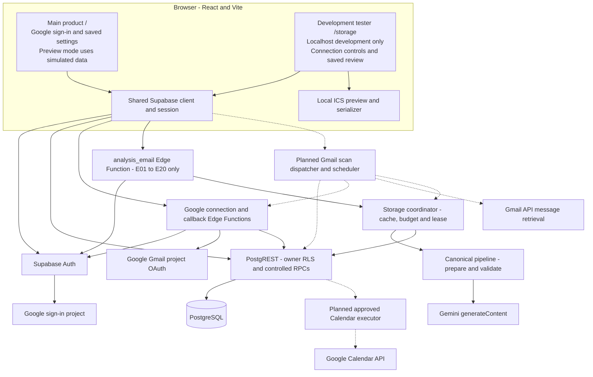

# InboxToTask architecture

Updated November 5, 2026. This is the current local implementation and its remaining integration boundaries. It does not establish that this architecture is deployed or that real Gmail scanning works. See [use cases](use-cases.md), [observability](observability.md), and [the implementation plan](../IMPLEMENTATION_PLAN.md).

## Components and data flow

Solid arrows show implemented code paths; extraction still requires an explicitly enabled fixture trial. Dashed arrows show planned integration. The diagram describes component responsibilities, not proof of live provider verification.

There is no vector database, embedding index, or autonomous tool-using agent in the current implementation. PostgreSQL stores structured application state; Gemini performs bounded structured extraction. The model cannot send email or execute calendar operations.

| Component | Implementation responsibility and limits |
| --- | --- |
| [React entry](../app/web/src/main.tsx) and [product UI](../app/web/src/App.tsx) | Product authentication/onboarding, saved scanning settings, and a separate simulated preview. Product persistent review and Gmail connection integration remain unfinished |
| [Development dashboard](../app/web/src/StorageDashboard.tsx) | Authenticated storage review, fixture trials, Google connection controls, and local ICS export; excluded from production builds |
| [Shared client](../app/web/src/supabase.ts) and [storage adapter](../app/web/src/storageAdapter.ts) | Shared session, owner reads, RPC requests, and fixed user-facing error mapping |
| [Google connection module](../app/supabase/functions/_shared/google-connection.mjs) | Separate Gmail OAuth, single-use state/PKCE, same-account checks, encrypted credentials, refresh leases, and disconnect/revocation handling |
| [Fixture endpoint](../app/supabase/functions/analysis_email/index.ts) | Verified-user, default-disabled fictional extraction boundary; accepts case IDs, not caller-selected bodies, rules, prompts, or owners |
| [Canonical pipeline](../app/pipeline/core.mjs) and [Gemini adapter](../app/pipeline/gemini.mjs) | Filtering of supplied fixtures/context, bounded preparation, one structured extraction request by default, schema/evidence/ownership validation |
| [Storage coordinator](../app/supabase/functions/_shared/storage.mjs) and [migrations](../app/supabase/migrations/) | Cache identities, budget reservations, leases, atomic persistence, user review, lifecycle fencing, and owner isolation |

## Identity, permissions, and trust boundaries

Google sign-in establishes app identity through Supabase Auth. Its root-origin product return is separate from the development callback. The browser reuses one shared Supabase client; requests do not gain authority from caller-supplied user IDs.

Gmail authorization uses a separate Google Cloud project/client from sign-in. The Edge Functions verify the app session and derive the owner server-side. OAuth state is single-use and time-limited; callbacks check the granted scopes and same-account identity before saving encrypted Gmail credentials. Gmail access/refresh tokens stay in the backend credential boundary, with AES-GCM keys supplied through private runtime configuration. The safe status RPC returns connection metadata, not credentials.

Connecting Gmail is not scanning consent. Owner-scoped saved settings use authenticated get/save RPCs, validation, an explicit consent disclosure version, pause state, bounded context limits, and revision checks. Legacy onboarding selections are a separate record and do not authorize processing. Saves invalidate older storage jobs; the future Gmail dispatcher must also enforce current settings and connection generations at each external boundary.

RLS protects browser table reads; controlled review/settings RPCs govern mutations. Privileged service RPCs handle extraction jobs and persistence. Credentials and private jobs are not exposed as browser-readable tables. Fixed search paths, scoped grants, ownership foreign keys, revision checks, and generation/lease checks supplement RLS.

## Current fictional extraction transaction

1. The browser submits a bundled case ID with a bearer session. The endpoint verifies the session, enabled flag, origin, method, request size, and fixed request contract.
2. The backend selects fictional input and adapts its inbox owner to the verified account. Canonical preparation applies inclusion/exclusion rules to the current message and each supplied context message, removes common quoted history conservatively, and enforces size limits.
3. The coordinator hashes the effective prepared payload and configuration for a user-scoped extraction identity. It claims a budget and lease before inference; a valid existing result can return a receipt without a model call.
4. Gemini returns structured output through the provider adapter. Canonical validation checks schema, evidence grounding, responsibility, and date/condition semantics. Uncertainty remains visible rather than becoming an automatic accepted task.
5. A service-only transaction rechecks ownership, generation, lease, and suppression state, then saves normalized suggestions, digest/waiting-for records, and bounded evidence. Failed child writes roll back the extraction transaction.
6. Authenticated review RPCs separately approve/edit/dismiss/complete records. Accepted/user-edited fields remain distinct from original proposals. Review operations do not require another inference request.

The pipeline receives fixture bodies already supplied in memory. It is not a Gmail retrieval boundary. The current fixture namespace remains restricted even though the storage schema reserves a Gmail namespace.

## Storage and lifecycle

| Storage group | Purpose |
| --- | --- |
| Onboarding preferences and `scan_settings` | Separate onboarding choices and explicit saved scanning permission/context/revision |
| `storage_sources`, `storage_extractions`, `storage_evidence` | Minimal source identity, validated classification/summary, and expiring supporting excerpts |
| `storage_suggestions`, `tasks`, task-source relations | Original proposals, review edits, accepted values, and provenance |
| Waiting-for/follow-up records | External commitments and dashboard reminders; no outgoing messages |
| Calendar operation records | Separate preview/approval state; no connected Calendar execution |
| Private jobs, attempts, usage, limits, and suppressions | Concurrency, budgets, retries, and prevention of stale/deleted-source recreation |
| Private Google connections and OAuth state | Encrypted backend Gmail credentials and protected connection lifecycle |

Full email bodies are transient in the processing design; evidence and summaries are still sensitive stored content. The current storage contract defaults supporting content to 30 days and completed-task deletion eligibility to 30 days after completion; undo resets eligibility. Cleanup code exists but scheduling is not enabled. Eligibility is not a promise of deletion at an exact time. Minimal suppression/source identifiers remain until account deletion; final retention choices and a complete user-facing account-deletion flow remain unfinished. See [the storage contract](../app/supabase/STORAGE.md) for precise semantics.

## Model configuration and reproducibility

The canonical [settings](../app/prompts/model-settings.json) select `gemini-3.8-flash`, LOW thinking, OpenAPI-style provider schema conversion, an 8,192 output-token cap, a 60-second timeout, and one provider attempt by default. The Edge endpoint permits an explicit server-side `GEMINI_MODEL` override and forces one attempt. The previously evaluated live candidate explicitly used `gemini-3.6-flash`; this did not change the canonical default. There is no silent fallback model.

Context configuration also has separate scopes: the canonical fixture/CLI pipeline defaults to at most **five** earlier messages within 30 days, while saved scanning settings start at **zero** earlier messages. The plan's proposal to use up to five as the real-scan starting default still requires confirmation. Current saved settings are not connected to Gmail retrieval; their values must not be described as the effective settings of a running scan. See [the context-default comparison](use-cases.md#context-defaults-current-configuration-versus-proposal) for bounds and starting character limits.

Prompts, schema, and settings live in [canonical sources](../app/prompts/). `npm.cmd run supabase:prepare` stages those sources and fixtures into the ignored Edge bundle. Generated bundles are not maintained as an independent implementation. Record effective settings when evaluating; a source default alone does not prove what a running service used.

## Remaining end-to-end integration

The planned Gmail path must retrieve metadata first, enforce current consent/rules before every body/context fetch, and recheck permissions before inference and saving. Empty inclusions or absent consent must process nothing. Subject inclusion semantics remain undecided; existing label/sender/domain OR inclusions and overriding exclusions must be preserved.

After a bounded manual path works, add incremental state, backlog approval, cooldowns, retry dispatch, progressive counts, and scheduled scans with the dashboard closed. The plan selects a **15-minute default scan interval**; this is not an exact arrival-time guarantee and does not imply a model call on every check. A **60-second manual-refresh cooldown is a proposal still awaiting confirmation**, not an implemented setting. An existing running scan should be reused rather than overlapped.

Product persistent review must use real saved records and clear account state on session changes. Optional Calendar onboarding must offer Connect / Skip for now, with later connection from Settings or Add to Calendar. Denial must leave Gmail/task features usable. The future Calendar executor requires separate event approval, retry-safe operation tracking, approved updates, and explicit undo of app-created events. Destination/scopes and whether Calendar shares the Gmail project remain open decisions; manual ICS export does not supply those capabilities. See [the planned Calendar walkthrough](use-cases.md#uc9-future-optional-calendar-connection-and-approved-event-lifecycle).

Vercel is the intended frontend host, with Supabase as backend. Current local verification and any separately inspected legacy hosted services do not establish a deployed version of this architecture. Hosted configuration, compatibility, migrations, functions, and end-to-end testing require a separately authorized rollout.
