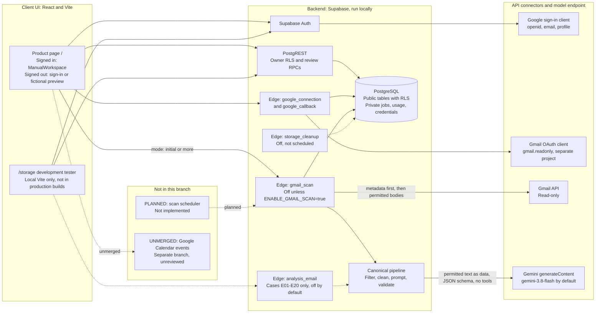
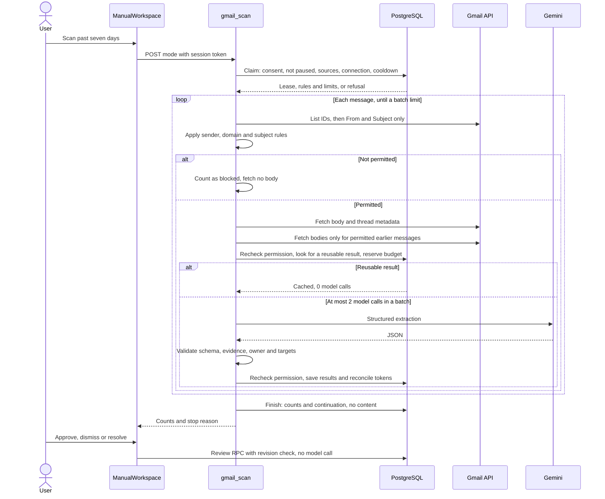

# InboxToTask architecture

Updated November 5, 2026. This describes the code on branch `mzheng/gmail-scan-hardening` and how it has been verified. Results are in [use cases](use-cases.md); limits are in [safety and privacy](safety_privacy.md) and [observability](observability.md).

## Status at a glance

| Part | State | Evidence |
| --- | --- | --- |
| Manual Gmail scan → Gemini → storage → review | Works locally | Live local on fictional mail ([UC8](use-cases.md#uc8-real-gmail-to-review-workflow)) and automated tests |
| Signed-in product page | Plain `ManualWorkspace` page ([App.tsx line 565](../app/web/src/App.tsx)) | Seeded local browser and live local |
| Designed dashboard and onboarding | **Not connected to real data.** Reachable only as a fictional preview | Code |
| Automatic scheduled scans | **Not implemented** | Code: no schedule exists |
| Hosted (Vercel and hosted Supabase) | **Not verified** | Some migrations are applied, but scanning is not deployed or enabled there and signed-in checks remain open ([current state](../CURRENT_STATE.md)) |
| Google Calendar event creation | **Not in this branch.** Exists only on an unmerged, unreviewed branch (`agents/proceed-with-the-minimal-google-calendar-integra`, `b6f84e6`) | Not evaluated here |
| ICS file export | Implemented on accepted tasks in the workspace and in the `/storage` development tester | Automated tests and an isolated browser check of the form; workspace button not browser-checked |

## End-to-end diagram

Solid lines exist in this branch. Dotted lines are off by default or, where labeled, not in this branch. There is **no vector store**, embedding index or autonomous agent.

## The manual Gmail flow

The handler rechecks the scan lease and saved permission before each external request ([retrieval](../app/pipeline/gmail-retrieval.mjs), [processor](../app/pipeline/gmail-processor.mjs), [endpoint](../app/supabase/functions/gmail_scan/index.ts)). If work remains, the user clicks **Scan more** after the 60-second cooldown. Nothing continues on its own, and results appear when a batch finishes: there is no streaming.

## Components

| Layer | Component | Responsibility |
| --- | --- | --- |
| Client UI | [ManualWorkspace](../app/web/src/ManualWorkspace.tsx), [manual scan adapter](../app/web/src/manualScanAdapter.ts), [source emails](../app/web/src/SourceEmails.tsx) | Scan, counts, review, before/after changes, manual resolution and Gmail links |
| Client UI | [App](../app/web/src/App.tsx) and preview adapter | Sign-in, routing, fictional preview with simulated actions |
| Client UI | [StorageDashboard](../app/web/src/StorageDashboard.tsx) | Development only: fixture trials, activity totals, ICS export, task deletion |
| Backend | [gmail_scan](../app/supabase/functions/gmail_scan/index.ts) | Authenticated manual scan, disabled by default |
| Backend | [Google connection](../app/supabase/functions/_shared/google-connection.mjs) | Separate Gmail OAuth, encrypted tokens, refresh and revocation |
| Backend | [Pipeline](../app/pipeline/) | Rules, body cleanup, prompt input, Gemini adapter, validation |
| Database | [Migrations](../app/supabase/migrations/) | Tables, RLS, service-only scan and storage functions, deletion triggers |
| Prompts | [Prompts](../app/prompts/) | System prompt with rule examples, output schemas, model settings |
| Connector | Gmail API | `list`, `metadata`, `full` and thread metadata, read-only, with Spam and Trash excluded |
| Model | Gemini `generateContent` | Structured JSON only; no tools, no conversation history |

## Trust boundaries

- **Identity:** every Edge call verifies the Supabase session and derives the owner on the server. The browser cannot name a user, prompt, rule or message.
- **Two Google permissions:** sign-in uses identity scopes only. Gmail uses a separate client and project with `gmail.readonly`. The verified Google address must match the signed-in user.
- **Consent is separate from connecting:** connecting reads no mail. A scan also needs saved consent, an exact sender or domain, and scanning unpaused.
- **Tokens stay in the backend:** Google tokens are AES-256-GCM encrypted in private tables. Keys are private function settings. `VITE_*` variables hold only public values.
- **The database is the final check:** service-only SQL rechecks rules, revision, generation and lease before reuse and before saving, so a late result cannot override a pause, permission change or deletion.

Details and tests are in [safety and privacy](safety_privacy.md).

## What is stored

| Stored | Where | Notes |
| --- | --- | --- |
| Rules, consent, pause, context limits | `scan_settings` | Revisioned; saving invalidates older work. New accounts default to 5 earlier messages within 90 days ([migration](../app/supabase/migrations/20261105200000_source_semantic_contract.sql)); existing users keep saved values |
| Sender, subject, date, Gmail IDs | `storage_sources`, including `permission_metadata` | Sensitive application data |
| Summaries and supporting excerpts | `storage_extractions`, `storage_evidence` | Default 30-day expiry, enforced only when cleanup runs |
| Suggestions, accepted tasks, proposed changes | `storage_suggestions`, `tasks`, `gmail_task_changes` | Model proposals stay separate from accepted values |
| Waiting-for records | `storage_waiting_for`, `storage_followups` | Saved; displayed only in the development tester |
| Jobs, attempts, usage, scan work | `private.storage_*`, `private.gmail_scan_work` | No browser access; see [observability](observability.md) |
| Reuse index | `private.gmail_result_cache` | Links a source and content hash to its extraction, with task fingerprints instead of accepted values. No browser access |
| Encrypted Google credentials | `private.google_connections` | No browser access |

**Not stored:** full email bodies, the prompt or request sent to Gemini, and raw model or provider errors.

## Model configuration

[Model settings](../app/prompts/model-settings.json) select `gemini-3.8-flash`, LOW thinking, an 8,192 output-token cap and a 60-second timeout. Gmail processing forces one provider attempt per claim. A server-side `GEMINI_MODEL` setting can override the model, and there is no silent fallback. Prompts and schema are canonical in [prompts](../app/prompts/); `npm.cmd run supabase:prepare` copies them into the ignored Edge bundle.

## Design decisions

| Decision | Reason | Cost |
| --- | --- | --- |
| No vector store | Context comes from the same Gmail thread plus accepted tasks found by thread, so retrieval is exact and permission-checked | No cross-thread matching; separate emails about one task stay separate |
| Metadata before bodies | Excluded mail is never read | More Gmail requests per message |
| Manual, bounded batches | Controls cost and keeps consent explicit during the trial | At most two model calls per batch, so a large backlog needs many clicks |
| Reuse results by content hash | Repeat scans make no model call (L14) | A prompt or settings change invalidates saved results |
| Backend-owned, code-only review | The model never changes accepted values; review costs no tokens | A person must review each item |
| Excerpts and a Gmail link, not stored bodies | Less sensitive data kept (chosen as a naive first version) | The full message stays in Gmail, and the link opens the whole conversation |

## Not yet built

Each item below is planned or open, with requirements in [the implementation plan](../IMPLEMENTATION_PLAN.md): real data in the designed dashboard, scheduled scans, approved-tester access, global budgets and a database kill switch, connected Calendar writes after review of the separate branch, a complete account-deletion flow, and a verified hosted rollout.
